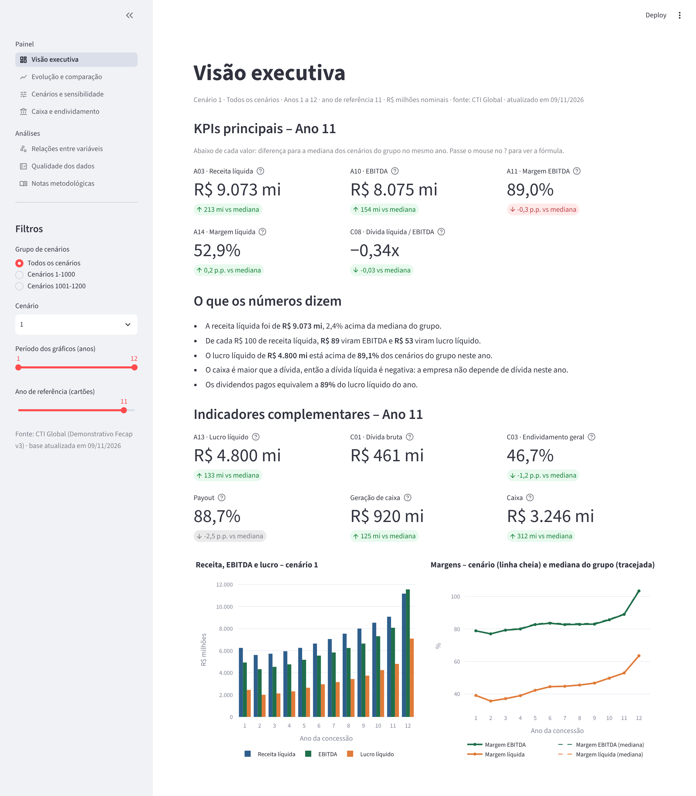
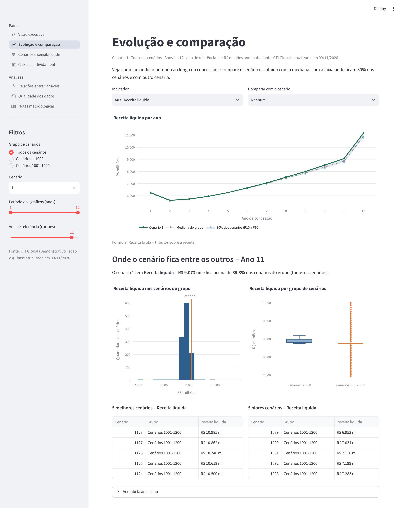
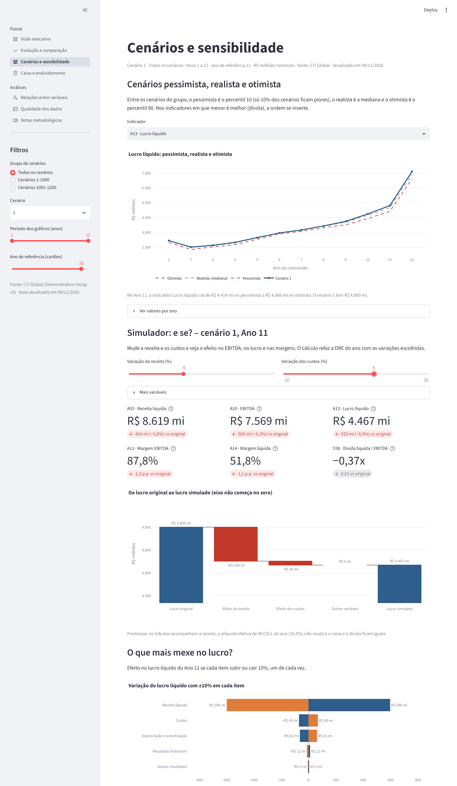
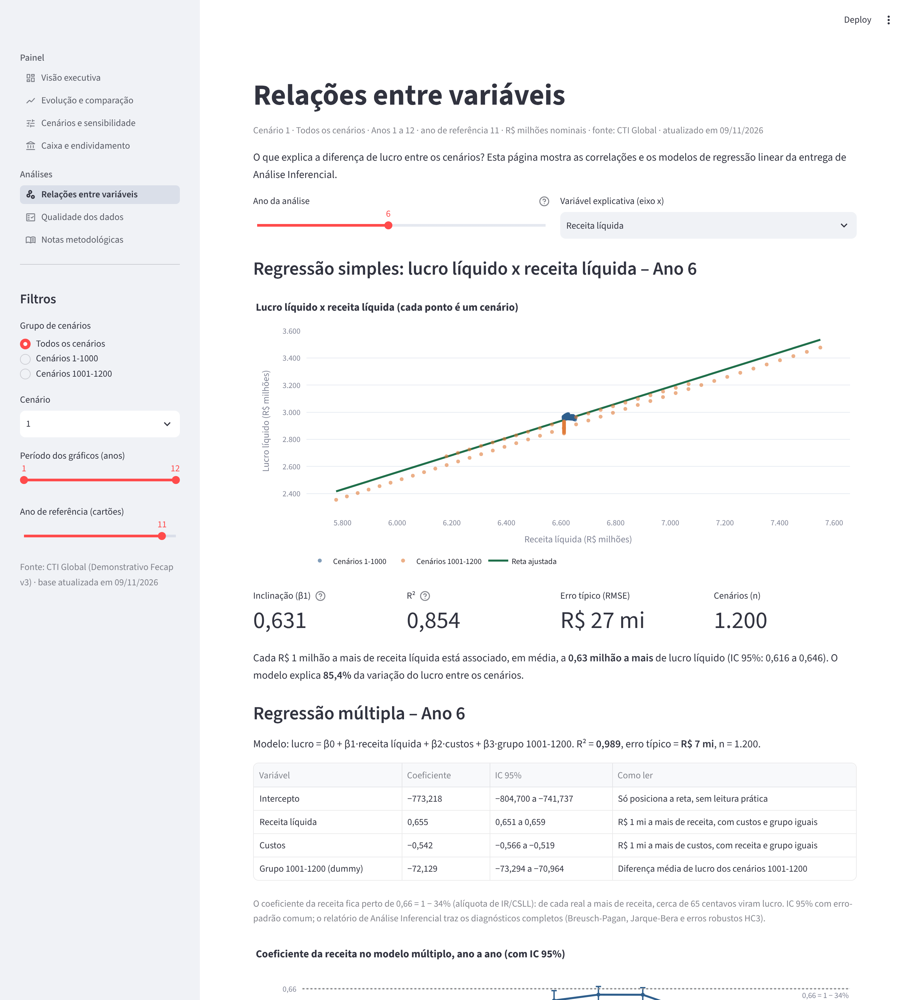

# Entrega 2 – Dashboard Funcional e Publicado

**Projeto:** Plataforma Analítica de Planejamento Financeiro (CTI Global)

**Unidade Curricular:** Projeto Interdisciplinar: Ciência de Dados

**Professor:** Eduardo Savino Gomes

**Curso:** Ciência da Computação – 4º semestre – 2º semestre de 2026

| Integrante | RA |
| --- | --- |
| Bruno Nobrega | 25027405 |
| Kaio Inglez | 24026741 |
| Mauricio Suster | 24026985 |
| Yuri Santana | 25027408 |

## Visão Geral

Construímos um dashboard em Streamlit, com 7 páginas, para apoiar decisões sobre os cenários financeiros simulados pela CTI. Ele lê direto a base que preparamos na Entrega 1, o arquivo `base_cti_processada.csv`, gerado pelo notebook `Preparacao_Dados_CTI.ipynb`. A base já chega limpa e padronizada, em R$ milhões, com 14.400 linhas (1.200 cenários × 12 anos) e 27 colunas. Toda vez que o app abre, ele confere de novo as regras de qualidade da Entrega 1.

O dashboard também junta o que as outras disciplinas produziram: os KPIs e a planilha de validação de Contabilidade, os modelos de regressão de Análise Inferencial e a arquitetura em camadas de Engenharia de Software.

| Página | O que mostra |
| --- | --- |
| Visão executiva | Os 5 KPIs principais, 6 indicadores complementares, um resumo do ano em frases e gráficos de receita, EBITDA, lucro e margens |
| Evolução e comparação | Qualquer indicador ano a ano, comparação com a mediana, com a faixa de 80% dos cenários e com outro cenário, distribuição e ranking |
| Cenários e sensibilidade | Cenários pessimista, realista e otimista, simulador "e se?" e o que mais mexe no lucro |
| Caixa e endividamento | Caixa, dívida, dividendos, investimentos, dívida líquida / EBITDA e payout |
| Relações entre variáveis | Regressão simples e múltipla do lucro, estabilidade do coeficiente ano a ano e mapa de correlação |
| Qualidade dos dados | Caminho dos dados, regras de qualidade conferidas na hora e dicionário resumido das colunas |
| Notas metodológicas | Fontes, fórmulas, premissas do simulador, contribuição de cada disciplina e limitações |



*Figura 1 – Visão executiva: filtros na barra lateral, os 5 KPIs principais e o resumo do ano.*

Os KPIs usam os mesmos códigos e as mesmas fórmulas do dicionário de KPIs. Conferimos os valores com a base da Entrega 1 e com o relatório de Análise Inferencial pelo script `testar_dashboard.py`, que passou nas 23 verificações.

## Documentação do Dashboard

### Fontes de dados

| Fonte | O que tem | Como o dashboard usa |
| --- | --- | --- |
| `Demonstrativo Fecap v3.csv`, enviado pela CTI Global dentro do `DADOS_FECAP.zip` | Balanço, DRE e fluxo de caixa de uma concessionária, 12 anos × 1.200 cenários | É a fonte original. O dashboard não lê esse arquivo direto |
| `base_cti_processada.csv`, gerada na Entrega 1 | 14.400 linhas × 27 colunas, valores em R$ milhões | É a base que o dashboard lê, na pasta `dados/` |

O dashboard usa 19 colunas da base: `cenario`, `ano`, `grupo_cenario`, `receita`, `tributos`, `custos`, `depreciacao_amortizacao`, `resultado_operacional`, `outros_resultados`, `resultado_financeiro`, `ir_cs`, `lucro_liquido`, `caixa`, `ativo_total`, `divida_bruta`, `patrimonio_liquido`, `investimentos`, `dividendos` e `geracao_caixa`. Não usamos fontes externas.

### Indicadores (KPIs)

Os 5 KPIs principais ficam na visão executiva:

| Código | KPI | Fórmula | Unidade | Como ler |
| --- | --- | --- | --- | --- |
| A03 | Receita líquida | Receita bruta − tributos sobre a receita | R$ milhões | Quanto a concessionária fatura depois dos tributos sobre a receita |
| A10 | EBITDA | Receita líquida − custos + outros resultados operacionais | R$ milhões | Resultado da operação antes de juros, IR/CSLL, depreciação e amortização |
| A11 | Margem EBITDA | EBITDA / receita líquida | % | Quanto de cada real de receita sobra como resultado operacional |
| A14 | Margem líquida | Lucro líquido / receita líquida | % | Quanto de cada real de receita vira lucro |
| C08 | Dívida líquida / EBITDA | (Dívida bruta − caixa) / EBITDA | vezes | Quantos anos de EBITDA pagariam a dívida líquida. Negativo quer dizer que o caixa é maior que a dívida |

Indicadores complementares, usados nas outras páginas:

| Código | Indicador | Fórmula |
| --- | --- | --- |
| A01 | Receita bruta | DRE - Receita |
| A04 | Custos | DRE - Custos |
| A13 | Lucro líquido | DRE - Resultado líquido |
| C01 | Dívida bruta | Empréstimos e financiamentos |
| C03 | Endividamento geral | (Ativo total − patrimônio líquido) / ativo total |
| – | Payout | Dividendos pagos / lucro líquido |
| – | Dívida líquida | Dívida bruta − caixa |
| – | Caixa, geração de caixa, dividendos e investimentos | Contas do balanço e do fluxo de caixa |

No código, as fórmulas ficam na função `calcular_indicadores`, no arquivo `dados.py`:

```python
d["receita_liquida"] = d["receita"] - d["tributos"]
d["ebitda"] = d["receita_liquida"] - d["custos"] + d["outros_resultados"]
d["margem_ebitda"] = d["ebitda"] / d["receita_liquida"]
d["margem_liquida"] = d["lucro_liquido"] / d["receita_liquida"]
d["divida_liquida"] = d["divida_bruta"] - d["caixa"]
d["divida_liquida_ebitda"] = d["divida_liquida"] / d["ebitda"]
```

### Filtros e comparações

Filtros da barra lateral, que valem para todas as páginas:

- **Grupo de cenários:** todos, cenários 1 a 1000 ou cenários 1001 a 1200.
- **Cenário:** lista com os cenários do grupo escolhido.
- **Período dos gráficos:** faixa de anos, de 1 a 12.
- **Ano de referência:** ano usado nos cartões. O padrão é o Ano 11, porque o Ano 12 é atípico.

Cada página também tem os seus controles: o indicador do gráfico, o cenário para comparar, as variações do simulador, o ano da regressão e a variável explicativa.

Comparações disponíveis:

- Cada cartão mostra a diferença do cenário para a mediana dos cenários do grupo no mesmo ano.
- O gráfico de evolução mostra o cenário, a mediana, a faixa do percentil 10 ao 90 e, se quiser, um segundo cenário, com uma tabela de diferenças.
- O histograma e o boxplot mostram onde o cenário fica entre os outros, e o ranking lista os 5 melhores e os 5 piores.
- A página de sensibilidade mostra os cenários pessimista (percentil 10), realista (mediana) e otimista (percentil 90).



*Figura 2 – Evolução e comparação: indicador ano a ano, distribuição, boxplot por grupo e ranking.*

### Análise de sensibilidade

O simulador refaz a DRE do ano escolhido com variações de −20% a +20% na receita, nos custos, na depreciação, no resultado financeiro e nos outros resultados. Depois mostra o novo EBITDA, o lucro e as margens, e um gráfico em cascata com o efeito de cada mudança no lucro.

Premissas do simulador:

- Os tributos acompanham a receita, então a receita líquida varia no mesmo percentual.
- A alíquota efetiva de IR/CSLL é a do próprio cenário e ano (cerca de 34,4%).
- Caixa e dívida não mudam.

Exemplo: no cenário 1, Ano 11, uma receita 5% menor com custos 5% maiores reduz o lucro líquido em R$ 333 milhões (−6,9%). O gráfico "O que mais mexe no lucro?" mostra que, nesse ano, 10% de variação na receita mudam o lucro em cerca de R$ 596 milhões, contra R$ 69 milhões nos custos.



*Figura 3 – Cenários pessimista, realista e otimista, simulador "e se?" e gráfico do que mais mexe no lucro.*

### Relações entre variáveis

A página de relações refaz no próprio dashboard os modelos do relatório de Análise Inferencial. No Ano 6, a regressão simples do lucro pela receita líquida tem inclinação de 0,631 e R² de 0,854. A regressão múltipla, com receita, custos e grupo, tem R² de 0,989 e coeficientes de 0,655 para a receita, −0,542 para os custos e −72,1 para o grupo 1001-1200. O coeficiente da receita fica entre 0,62 e 0,66 em todos os anos, perto de 1 − 34% de IR/CSLL.



*Figura 4 – Regressão simples e múltipla do lucro líquido no Ano 6.*

### Qualidade dos dados e mensagens de erro

A página de qualidade confere 12 regras toda vez que o app abre. Dez passam em todas as linhas: uma linha por cenário e ano, 12 anos por cenário, receita líquida, EBITDA, margens e dívida líquida iguais às da Entrega 1, a DRE fechando e tributos entre 5% e 10% da receita. Duas aparecem como "Atenção" porque são situações conhecidas do Ano 12: o patrimônio líquido vazio e a margem EBITDA acima de 100%.

O dashboard avisa quando algo dá errado: se a base não está na pasta `dados/`, se faltam colunas ou se os filtros não deixam nenhum dado.

### Limitações

- Os dados são cenários simulados pela CTI, não resultados reais da empresa. Os valores são nominais, sem correção pela inflação.
- O EBITDA é calculado pela DRE, como no dicionário. O arquivo traz outra linha de EBITDA, em média R$ 301 milhões maior, que não usamos.
- O Ano 12 é atípico porque é o fim da concessão: a dívida é zerada, os dividendos sobem muito (mediana de R$ 10 bilhões) e a margem EBITDA passa de 100% em todos os cenários.
- O patrimônio líquido não existe no Ano 12, então o endividamento geral fica n/a nesse ano.
- Os cenários 1001 a 1200 se comportam de forma diferente dos cenários 1 a 1000, por isso existe o filtro de grupo.
- O simulador muda um ano de cada vez e não recalcula os anos seguintes.
- As comparações e as regressões mostram associação entre variáveis, não causa e efeito.
- Os dados da CTI são confidenciais, então a publicação na nuvem depende da autorização da empresa.

## Instruções de Execução

### Rodar localmente

1. Instale o Python 3.10 ou mais novo.
2. Abra o terminal na pasta do dashboard:

   ```sh
   cd "src/Entrega 2/dashboard_cti"
   ```

3. Instale as bibliotecas:

   ```sh
   python -m pip install -r requirements.txt
   ```

4. Confira se o arquivo `dados/base_cti_processada.csv` está na pasta. Se não estiver, rode o notebook `Preparacao_Dados_CTI.ipynb` da Entrega 1 e copie o arquivo gerado para `dados/`.
5. Rode o dashboard:

   ```sh
   python -m streamlit run app.py
   ```

   No Windows, se `python` não funcionar, use `py -m streamlit run app.py`.
6. O navegador abre sozinho em `http://localhost:8501`. As páginas ficam no menu da barra lateral.

Para rodar os testes:

```sh
python testar_dashboard.py
```

Resultado esperado: `0 erro(s)`.

### Dashboard publicado na nuvem

Link do dashboard: `https://____________________.streamlit.app` (preencher depois de publicar)

Para acessar, é só abrir o link no navegador. Não precisa instalar nada.

Como publicar no Streamlit Community Cloud:

1. Envie a pasta `dashboard_cti` para o GitHub, com o `requirements.txt` e a pasta `dados/`.
2. Entre em [share.streamlit.io](https://share.streamlit.io) com a conta do GitHub.
3. Clique em **Create app**, escolha o repositório, o branch `main` e o arquivo principal `src/Entrega 2/dashboard_cti/app.py`.
4. Clique em **Deploy** e copie o link gerado para este documento.
5. Depois disso, cada push no GitHub atualiza o app sozinho.

Antes de publicar, confirme com a CTI se a base pode ficar no repositório. Se não puder, use um repositório privado.

## Código Base do Dashboard

O código é separado em camadas: `dados.py` lê a base e faz as contas, `formatos.py` cuida dos números e dos gráficos, `app.py` monta os filtros e o menu, e cada página fica num arquivo da pasta `paginas/`.

```text
dashboard_cti/
├── app.py                    # arquivo principal: leitura, filtros e menu de páginas
├── dados.py                  # base, KPIs, regras de qualidade, regressão e simulador
├── formatos.py               # números no padrão brasileiro, cores e layout dos gráficos
├── testar_dashboard.py       # testes automáticos
├── requirements.txt          # bibliotecas
├── README.md                 # esta documentação
├── paginas/
│   ├── visao_executiva.py
│   ├── evolucao.py
│   ├── sensibilidade.py
│   ├── caixa.py
│   ├── relacoes.py
│   ├── qualidade.py
│   └── notas.py
├── imagens/                  # prints das telas usados na documentação
└── dados/
    └── base_cti_processada.csv   # base final da Entrega 1
```

Os comentários com `>>>` no código mostram onde mexer quando a base final mudar:

- `ARQUIVO`, em `dados.py`: caminho da base da Entrega 1.
- `KPIS` e `calcular_indicadores`, em `dados.py`: lista dos 5 indicadores principais e as fórmulas.

Abaixo estão os dois arquivos principais: `app.py`, com a leitura da base, os filtros e o menu, e `dados.py`, com os KPIs. O código das páginas está na pasta `paginas/` do repositório.

`requirements.txt`:

```text
streamlit==1.66.1
pandas==3.0.5
plotly==7.1.0
numpy
```

`app.py`:

```python
# app.py
# Dashboard CTI - Plataforma Analítica de Planejamento Financeiro
# PI Ciência de Dados - Entrega 2 / Projeto final - 4º semestre CCOMP (FECAP)
# Professor: Eduardo Savino Gomes
# Integrantes: Bruno Nobrega, Kaio Inglez, Mauricio Suster e Yuri Santana
#
# Arquivo principal: lê a base da Entrega 1, monta os filtros da barra lateral (valem para todas as
# páginas) e abre a página escolhida no menu.
# Para rodar:  python -m streamlit run app.py

import os
from datetime import datetime

import streamlit as st

from dados import ARQUIVO, carregar_base, validar_colunas, calcular_indicadores

st.set_page_config(page_title="Dashboard CTI", page_icon="📊", layout="wide")

# ---------------- leitura dos dados (com mensagens de erro) ----------------
if not os.path.exists(ARQUIVO):
    st.error("Base de dados não encontrada. Coloque o arquivo base_cti_processada.csv (Entrega 1) na pasta dados/.")
    st.stop()

base = carregar_base(ARQUIVO)
faltando = validar_colunas(base)
if faltando:
    st.error(f"A base não tem as colunas: {', '.join(faltando)}. Confira se é a base final da Entrega 1.")
    st.stop()

d = calcular_indicadores(base)
atualizado = datetime.fromtimestamp(os.path.getmtime(ARQUIVO)).strftime("%d/%m/%Y")

# ---------------- menu de páginas ----------------
paginas = {
    "Painel": [
        st.Page("paginas/visao_executiva.py", title="Visão executiva", icon=":material/dashboard:", default=True),
        st.Page("paginas/evolucao.py", title="Evolução e comparação", icon=":material/show_chart:"),
        st.Page("paginas/sensibilidade.py", title="Cenários e sensibilidade", icon=":material/tune:"),
        st.Page("paginas/caixa.py", title="Caixa e endividamento", icon=":material/account_balance:"),
    ],
    "Análises": [
        st.Page("paginas/relacoes.py", title="Relações entre variáveis", icon=":material/scatter_plot:"),
        st.Page("paginas/qualidade.py", title="Qualidade dos dados", icon=":material/fact_check:"),
        st.Page("paginas/notas.py", title="Notas metodológicas", icon=":material/menu_book:"),
    ],
}
navegacao = st.navigation(paginas)

# ---------------- filtros (barra lateral, valem para todas as páginas) ----------------
st.sidebar.header("Filtros")
grupos = ["Todos os cenários"] + sorted(d["grupo_cenario"].unique())
grupo = st.sidebar.radio("Grupo de cenários", grupos, key="grupo")
d_grupo = d if grupo == "Todos os cenários" else d[d["grupo_cenario"] == grupo]

cenario = st.sidebar.selectbox("Cenário", sorted(d_grupo["cenario"].unique()), key="cenario")
ano_ini, ano_fim = st.sidebar.slider("Período dos gráficos (anos)", 1, 12, (1, 12), key="periodo")
if ano_ini < ano_fim:   # o Ano 12 é atípico (fim da concessão), por isso o padrão é o Ano 11
    ano_ref = st.sidebar.slider("Ano de referência (cartões)", ano_ini, ano_fim, min(max(11, ano_ini), ano_fim),
                                key="ano_ref")
else:
    ano_ref = ano_fim
st.sidebar.caption(f"Fonte: CTI Global (Demonstrativo Fecap v3) · base atualizada em {atualizado}")

periodo = d_grupo[d_grupo["ano"].between(ano_ini, ano_fim)]
cen = periodo[periodo["cenario"] == cenario].set_index("ano")
if cen.empty:
    st.warning("Não há dados para os filtros escolhidos. Mude o grupo, o cenário ou o período.")
    st.stop()

# tudo que as páginas precisam fica guardado aqui
st.session_state["ctx"] = {
    "d": d, "d_grupo": d_grupo, "periodo": periodo, "cen": cen, "mediana": periodo.groupby("ano").median(numeric_only=True),
    "n_colunas_base": base.shape[1], "grupo": grupo, "cenario": cenario, "ano_ini": ano_ini, "ano_fim": ano_fim, "ano_ref": ano_ref, "atualizado": atualizado,
}

navegacao.run()
```

`dados.py`:

```python
# dados.py
# Leitura da base, cálculo dos indicadores, regras de qualidade, regressão e simulação.
# PI Ciência de Dados - Entrega 2 - Dashboard CTI (FECAP)
# Integrantes: Bruno Nobrega, Kaio Inglez, Mauricio Suster e Yuri Santana

import os

import numpy as np
import pandas as pd
import streamlit as st

from formatos import br

# >>> DADOS: caminho da base final da Entrega 1 (saída do notebook Preparacao_Dados_CTI.ipynb).
#     Se a base mudar de nome ou de pasta, altere só esta linha.
ARQUIVO = os.path.join(os.path.dirname(os.path.abspath(__file__)), "dados", "base_cti_processada.csv")

# colunas da base que o dashboard usa (valores em R$ milhões)
COLUNAS_NECESSARIAS = ["cenario", "ano", "grupo_cenario", "receita", "tributos", "custos", "depreciacao_amortizacao",
                       "resultado_operacional", "outros_resultados", "resultado_financeiro", "ir_cs", "lucro_liquido",
                       "caixa", "ativo_total", "divida_bruta", "patrimonio_liquido", "investimentos", "dividendos",
                       "geracao_caixa"]

# >>> KPIs principais (os 5 do dicionário que ficam na visão executiva):
#     (código, nome, coluna, tipo, fórmula). Tipos: rs = R$ milhões, pct = %, x = vezes.
KPIS = [
    ("A03", "Receita líquida", "receita_liquida", "rs", "Receita bruta − tributos sobre a receita"),
    ("A10", "EBITDA", "ebitda", "rs", "Receita líquida − custos + outros resultados operacionais"),
    ("A11", "Margem EBITDA", "margem_ebitda", "pct", "EBITDA / receita líquida"),
    ("A14", "Margem líquida", "margem_liquida", "pct", "Lucro líquido / receita líquida"),
    ("C08", "Dívida líquida / EBITDA", "divida_liquida_ebitda", "x", "(Dívida bruta − caixa) / EBITDA"),
]

# indicadores complementares (também do dicionário, ou de apoio quando não têm código)
COMPLEMENTARES = [
    ("A01", "Receita bruta", "receita", "rs", "DRE - Receita"),
    ("A04", "Custos", "custos", "rs", "DRE - Custos (sinal positivo)"),
    ("A13", "Lucro líquido", "lucro_liquido", "rs", "DRE - Resultado líquido"),
    ("C01", "Dívida bruta", "divida_bruta", "rs", "Empréstimos e financiamentos"),
    ("C03", "Endividamento geral", "endividamento_geral", "pct", "(Ativo total − patrimônio líquido) / ativo total"),
    ("–", "Payout", "payout", "pct", "Dividendos pagos / lucro líquido"),
    ("–", "Geração de caixa", "geracao_caixa", "rs", "Variação do caixa no ano"),
    ("–", "Caixa", "caixa", "rs", "Disponível no fim do ano"),
    ("–", "Dívida líquida", "divida_liquida", "rs", "Dívida bruta − caixa"),
    ("–", "Dividendos pagos", "dividendos", "rs", "Distribuição para os acionistas"),
    ("–", "Investimentos", "investimentos", "rs", "Investimentos pagos no ano"),
]
TODOS = KPIS + COMPLEMENTARES
MENOR_MELHOR = {"divida_liquida_ebitda", "endividamento_geral", "custos", "divida_bruta", "divida_liquida"}


@st.cache_data
def carregar_base(caminho=ARQUIVO):
    return pd.read_csv(caminho, sep=";", decimal=",")


def validar_colunas(base):
    """Lista as colunas que faltam na base (lista vazia = tudo certo)."""
    return [c for c in COLUNAS_NECESSARIAS if c not in base.columns]


@st.cache_data
def calcular_indicadores(base):
    """Calcula os KPIs a partir das colunas da base (mesmas fórmulas do dicionário de KPIs)."""
    d = base.copy()
    for col in ["receita_liquida", "ebitda", "margem_ebitda", "margem_liquida", "divida_liquida"]:   # guarda as colunas da Entrega 1
        if col in d.columns:
            d[f"{col}_e1"] = d[col]
    d["receita_liquida"] = d["receita"] - d["tributos"]
    d["ebitda"] = d["receita_liquida"] - d["custos"] + d["outros_resultados"]
    d["margem_ebitda"] = d["ebitda"] / d["receita_liquida"]
    d["margem_liquida"] = d["lucro_liquido"] / d["receita_liquida"]
    d["divida_liquida"] = d["divida_bruta"] - d["caixa"]
    d["divida_liquida_ebitda"] = d["divida_liquida"] / d["ebitda"]
    d["endividamento_geral"] = (d["ativo_total"] - d["patrimonio_liquido"]) / d["ativo_total"]
    d["payout"] = d["dividendos"] / d["lucro_liquido"]
    d["lair"] = d["lucro_liquido"] + d["ir_cs"]                       # lucro antes do IR/CSLL
    d["aliquota_efetiva"] = d["ir_cs"] / d["lair"]
    d["grupo2"] = (d["cenario"] > 1000).astype(int)
    return d


def regras_qualidade(d):
    """Regras de qualidade da Entrega 1 conferidas de novo no dashboard."""
    por_cenario = d.groupby("cenario")["ano"].nunique()
    vazios = d[COLUNAS_NECESSARIAS].isna().sum()
    anos_vazios = sorted(d.loc[d[COLUNAS_NECESSARIAS].isna().any(axis=1), "ano"].unique())
    anos_txt = lambda anos: ("Ano " if len(anos) == 1 else "Anos ") + ", ".join(map(str, anos))
    texto_vazios = (f"{br(vazios.sum())} células vazias em {', '.join(vazios[vazios > 0].index)} "
                    f"({anos_txt(anos_vazios)})") if vazios.sum() else "nenhuma célula vazia"
    acima = d["margem_ebitda"] > 1
    texto_margem = (f"{br(acima.sum())} linhas ({anos_txt(sorted(d.loc[acima, 'ano'].unique()))})"
                    if acima.any() else "nenhuma linha")
    regras = [
        ("Uma linha por cenário e ano", f"{d.duplicated(['cenario', 'ano']).sum()} linhas repetidas",
         d.duplicated(["cenario", "ano"]).sum() == 0),
        ("12 anos em todos os cenários", f"{(por_cenario != 12).sum()} cenários incompletos", (por_cenario == 12).all()),
    ]
    for col, nome, un in [("receita_liquida", "Receita líquida igual à da Entrega 1", " mi"),
                          ("ebitda", "EBITDA igual ao da Entrega 1", " mi"),
                          ("margem_ebitda", "Margem EBITDA igual à da Entrega 1", " p.p."),
                          ("margem_liquida", "Margem líquida igual à da Entrega 1", " p.p."),
                          ("divida_liquida", "Dívida líquida igual à da Entrega 1", " mi")]:
        if f"{col}_e1" in d.columns:
            dif = (d[col] - d[f"{col}_e1"]).abs().max() * (100 if un == " p.p." else 1)
            regras.append((nome, f"maior diferença: {br(dif, 4)}{un}", dif < 0.01))
    regras += [
        ("Resultado operacional = receita líquida − custos − depreciação",
         f"maior diferença: {br(abs(d['receita_liquida'] - d['custos'] - d['depreciacao_amortizacao'] - d['resultado_operacional']).max(), 4)} mi",
         abs(d["receita_liquida"] - d["custos"] - d["depreciacao_amortizacao"] - d["resultado_operacional"]).max() < 0.01),
        ("Lucro = operacional + outros + financeiro − IR/CSLL",
         f"maior diferença: {br(abs(d['resultado_operacional'] + d['outros_resultados'] + d['resultado_financeiro'] - d['ir_cs'] - d['lucro_liquido']).max(), 4)} mi",
         abs(d["resultado_operacional"] + d["outros_resultados"] + d["resultado_financeiro"] - d["ir_cs"] - d["lucro_liquido"]).max() < 0.01),
        ("Tributos entre 5% e 10% da receita",
         f"de {br(d['tributos'].div(d['receita']).min() * 100, 1)}% a {br(d['tributos'].div(d['receita']).max() * 100, 1)}%",
         d["tributos"].div(d["receita"]).between(0.05, 0.10).all()),
        ("Valores vazios", texto_vazios, None if vazios.sum() else True),
        ("Margem EBITDA acima de 100%", texto_margem, None if acima.any() else True),
    ]
    return pd.DataFrame([{"Regra": r, "Resultado": res, "Situação": "OK" if ok else ("Atenção" if ok is None else "Erro")}
                         for r, res, ok in regras])


def ols(d, y, xs):
    """Regressão linear por mínimos quadrados (numpy). Devolve coeficientes, IC 95%, R² e RMSE."""
    dados = d[[y] + xs].dropna()
    X = np.column_stack([np.ones(len(dados))] + [dados[x].to_numpy() for x in xs])
    Y = dados[y].to_numpy()
    beta, *_ = np.linalg.lstsq(X, Y, rcond=None)
    resid = Y - X @ beta
    n, k = X.shape
    sigma2 = resid @ resid / (n - k)
    ep = np.sqrt(np.diag(sigma2 * np.linalg.inv(X.T @ X)))
    r2 = 1 - (resid @ resid) / ((Y - Y.mean()) @ (Y - Y.mean()))
    tabela = pd.DataFrame({"coef": beta, "ep": ep, "ic_min": beta - 1.96 * ep, "ic_max": beta + 1.96 * ep},
                          index=["Intercepto"] + xs)
    return tabela, r2, np.sqrt(sigma2), n


def lucro_simulado(linha, var_receita=0.0, var_custos=0.0, var_dep=0.0, var_fin=0.0, var_outros=0.0):
    """Recalcula EBITDA e lucro de uma linha (cenário e ano) com variações em %.
    Premissas: os tributos acompanham a receita, a alíquota efetiva de IR/CSLL é a do próprio ano
    e não há IR/CSLL quando o resultado antes do imposto fica negativo."""
    rl = linha["receita_liquida"] * (1 + var_receita)
    custos = linha["custos"] * (1 + var_custos)
    dep = linha["depreciacao_amortizacao"] * (1 + var_dep)
    outros = linha["outros_resultados"] * (1 + var_outros)
    fin = linha["resultado_financeiro"] * (1 + var_fin)
    ebitda = rl - custos + outros
    lair = ebitda - dep + fin
    lucro = lair * (1 - linha["aliquota_efetiva"]) if lair > 0 else lair
    divida_liq = linha["divida_bruta"] - linha["caixa"]
    return {"receita_liquida": rl, "custos": custos, "ebitda": ebitda, "margem_ebitda": ebitda / rl,
            "lucro_liquido": lucro, "margem_liquida": lucro / rl, "divida_liquida_ebitda": divida_liq / ebitda}


# descrição das colunas da base (dicionário de dados resumido da Entrega 1)
DESCRICOES = {
    "cenario": "Número do cenário (1 a 1.200)", "ano": "Ano da concessão (1 a 12)",
    "grupo_cenario": "Grupo do cenário (1-1000 ou 1001-1200)", "receita": "DRE - Receita (bruta)",
    "tributos": "DRE - Tributos sobre a receita", "custos": "DRE - Custos",
    "depreciacao_amortizacao": "DRE - Depreciação e amortização", "resultado_operacional": "DRE - Resultado operacional",
    "outros_resultados": "DRE - Outros resultados operacionais", "resultado_financeiro": "DRE - Resultado financeiro",
    "ir_cs": "DRE - IR e CSLL", "lucro_liquido": "DRE - Resultado líquido", "caixa": "BAL - Disponível",
    "ativo_total": "BAL - Total do ativo", "divida_bruta": "BAL - Empréstimos e financiamentos",
    "patrimonio_liquido": "BAL - Patrimônio líquido", "investimentos": "FLU - Investimentos",
    "dividendos": "FLU - Distribuição para acionistas", "geracao_caixa": "FLU - Geração de caixa",
}
```
